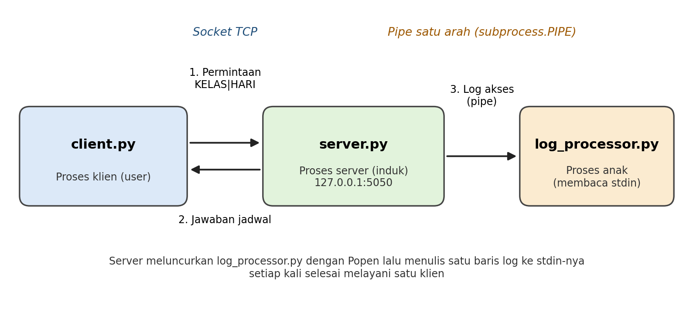

# K-1 Implementasi Komunikasi Antarproses (IPC)

Tugas Kelompok K-1, mata kuliah Sistem Operasi (USA-WP2260110), Kelas A, Program Studi S1 Informatika, Fakultas Teknologi Informasi, Universitas Sebelas April.
Tema kelas: Server Layanan Akademik Kampus.

- Kelompok: [ISI nomor kelompok]
- Anggota: [ISI nama dan NIM anggota]
- Dosen pengampu: Muhammad Agreindra Helmiawan, S.Kom., M.T.

## Deskripsi

Program klien-server untuk layanan cek jadwal kuliah kelas IF-IIIA. Klien mengirim permintaan lewat socket TCP, server membalas dengan jadwal, lalu server meneruskan log akses lewat pipe ke proses pemroses log.

Mekanisme IPC yang dipakai adalah message passing dengan dua saluran:

1. Socket TCP antara `client.py` dan `server.py` (dua arah).
2. Pipe satu arah dari `server.py` ke `log_processor.py`, dibuat dengan `subprocess.Popen(..., stdin=subprocess.PIPE)`.



## Struktur Repositori

| Berkas | Fungsi |
|---|---|
| `server.py` | Server socket di 127.0.0.1:5050, menyimpan jadwal, menjalankan `log_processor.py` sebagai proses anak, dan menulis log ke pipe |
| `client.py` | Klien yang meminta kelas dan hari, lalu menampilkan jadwal dari server |
| `log_processor.py` | Pemroses log yang membaca stdin (ujung pipe) dan menampilkan setiap baris log |
| `tests/kumpulkan_data_uji.sh` | Skrip bantu untuk mengumpulkan spesifikasi VM dan menjalankan uji server mati serta format salah |
| `docs/diagram_alur_ipc.png` | Diagram alur komunikasi |

## Kebutuhan

- Python 3.12 atau lebih baru (diuji pada Python 3.12.3, Ubuntu 24.04.5 LTS)
- Tidak ada pustaka tambahan, hanya modul bawaan Python (`socket`, `subprocess`, `sys`, `datetime`)

## Cara Menjalankan

Buka dua terminal pada folder repositori ini.

Terminal 1 (server):

```bash
python3 -u server.py
```

Terminal 2 (klien):

```bash
python3 client.py
```

Masukkan kelas (contoh `IF-IIIA`) dan hari (contoh `Rabu`). Hari yang tersedia adalah Rabu, Kamis, dan Sabtu. Format permintaan yang dikirim klien adalah `KELAS|HARI`. Hentikan server dengan `Ctrl+C`.

## Contoh Keluaran

Terminal server:

```text
[SERVER] Berjalan di 127.0.0.1:5050
[SERVER] Menunggu client...
[LOG PROCESSOR] Siap menerima log melalui pipe.
[SERVER] Permintaan IF-IIIA / sabtu
[LOG DITERIMA] 2026-10-11 06:42:01 | client=127.0.0.1:56516 kelas=IF-IIIA hari=sabtu status=OK
[SERVER] Permintaan IF-IIIA / senin
[LOG DITERIMA] 2026-10-11 06:42:55 | client=127.0.0.1:43268 kelas=IF-IIIA hari=senin status=TIDAK DITEMUKAN
```

Terminal klien:

```text
Masukkan kelas (contoh IF-IIIA): IF-IIIA
Masukkan hari (contoh Rabu): Sabtu

=== HASIL CEK JADWAL ===
Jadwal IF-IIIA hari Sabtu:
08.00 - 10.29 | Arsitektur dan Organisasi Komputer | Ruang 10
10.30 - 12.59 | Rekayasa Perangkat Lunak | Ruang 10
```

## Pengujian Tambahan

```bash
bash tests/kumpulkan_data_uji.sh
```

Skrip ini menampilkan spesifikasi VM, lalu menjalankan dua skenario: klien dijalankan saat server mati dan pesan dikirim tanpa pemisah `|`. Pastikan `server.py` tidak sedang berjalan sebelum menjalankannya.

## Keterbatasan yang Diketahui

- Server melayani satu klien pada satu waktu.
- Pipe hanya satu arah dan hanya antara proses induk dan anak.
- Server membaca permintaan dengan satu kali `recv(1024)` tanpa pembatas pesan.
- Status log ditentukan dari teks jawaban, sehingga permintaan berformat salah tetap tercatat `OK`.
- Penulisan ke pipe belum menangani `BrokenPipeError` jika pemroses log berhenti.
- Log hanya ditampilkan di terminal dan belum disimpan ke berkas.
